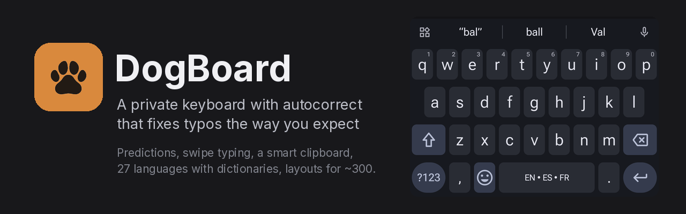
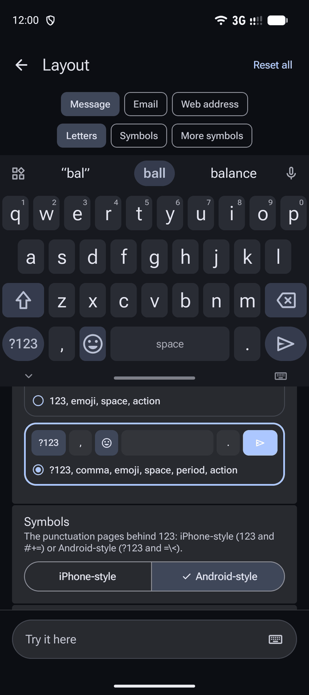
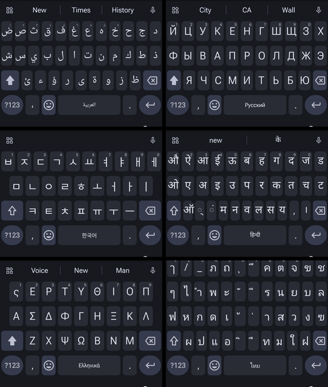
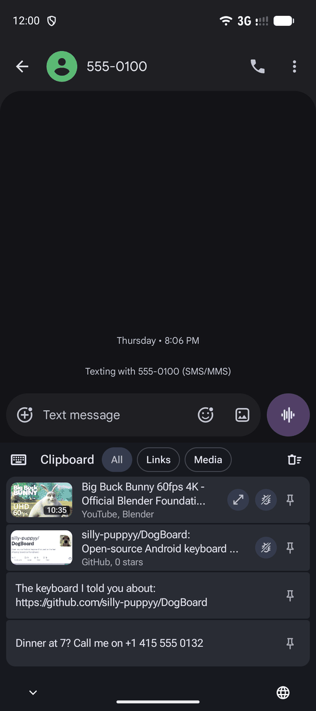
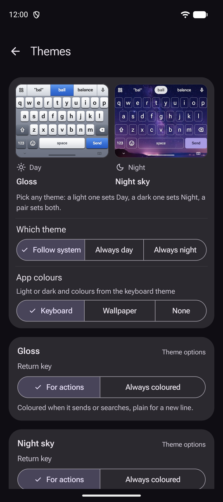

<p align="center"></p>

<p align="center">
  <a href="https://github.com/silly-puppyy/DogBoard/releases/latest"></a>
  <a href="https://github.com/silly-puppyy/DogBoard/releases"></a>
  
  <a href="LICENSE"></a>
</p>

<p align="center">
  <a href="https://github.com/silly-puppyy/DogBoard/releases/latest"></a>
  &nbsp;
  <a href="https://apps.obtainium.imranr.dev/redirect?r=obtainium://add/https://github.com/silly-puppyy/DogBoard"></a>
  &nbsp;
  <a href="https://github.com/silly-puppyy/DogBoard-fdroid"></a>
</p>

DogBoard is an open-source Android keyboard focused on the feel of typing: an accurate touch model, autocorrect
that fixes what you meant without changing what you didn't, next-word prediction, swipe typing and a clipboard that
understands what you copy. Everything runs on your phone; nothing you type leaves it.

## What it does

<table>
  <tr>
    <td width="25%" align="center"><br><b>Your layout</b><br>Bottom row, symbol pages, number row and key hints, Android or iPhone style, previewed live.</td>
    <td width="25%" align="center"><br><b>Your languages</b><br>Layouts for about 300 languages, dictionaries for 27, and up to three typed at once without switching.</td>
    <td width="25%" align="center"><br><b>A smart clipboard</b><br>Link previews, short links expanded, trackers removed, phone numbers and addresses as chips.</td>
    <td width="25%" align="center"><br><b>Your look and sound</b><br>Themes for day and night, your own photo or gradient, and key sounds to match.</td>
  </tr>
</table>

- **Autocorrect and predictions:** a touch model that knows where fingers actually land, a word model and a small
  on-device neural model; three strengths, from careful to bold.
- **Swipe typing** on every layout, with a model trained on how people really swipe.
- **Private by design:** no accounts, no analytics. The internet is used only to download the dictionaries of
  languages you add, and for the link features in the clipboard, which are off until you turn them on.

## Install

Download `DogBoard-<version>.apk` from the [latest release](https://github.com/silly-puppyy/DogBoard/releases/latest)
(Android 10 or newer, ARM phones). DogBoard checks for updates itself (About › Check for updates now). On first
start it downloads its English dictionary (about 50 MB); it types offline until then.

To get updates through an app store instead:

- **F-Droid** (or Droid-ify, Neo Store): add DogBoard's own repository, `https://silly-puppyy.github.io/DogBoard-fdroid/repo`
  (Settings › Repositories › **+**), or open
  [this link](https://silly-puppyy.github.io/DogBoard-fdroid/repo?fingerprint=CB8395B4B68B550E93220C23115EDABEEEBF0F191DCADB987CBFAA96EE4FAA83)
  on your phone. Repository key SHA-256:
  `CB 83 95 B4 B6 8B 55 0E 93 22 0C 23 11 5E DA BE EE BF 0F 19 1D CA DB 98 7C BF AA 96 EE 4F AA 83`.
- **[Obtainium](https://obtainium.imranr.dev/):** tap **Add app**, paste `https://github.com/silly-puppyy/DogBoard`,
  and tap **Add**. Obtainium then installs each new release from this page.

Every release is signed with the same key. Certificate SHA-256:
`ED:8D:A3:6A:7C:38:0D:C2:10:3F:E2:01:A3:99:1A:01:97:AC:7F:0D:49:E7:9C:FA:B5:D3:F9:74:BF:40:63:B1`

## Status

In use day to day. Typing engine (touch model, autocorrect, predictions), swipe typing, clipboard,
themes and downloadable languages are in place; more languages and swipe models are being added.

## Building

Requirements: JDK 17, Android SDK (compileSdk 37), NDK 29, CMake 4.1, and a Rust toolchain
installed via `rustup`.

```sh
./gradlew :app:assembleDebug
```

The screenshots above are taken again with `tools/screenshots/readme_shots.py` on the emulator.

## Credits

DogBoard is a fork of [FlorisBoard](https://github.com/florisboard/florisboard)
by Patrick Goldinger and the FlorisBoard contributors, and like it is licensed under the
[Apache License 2.0](LICENSE). The upstream README is kept as
[README.florisboard.md](README.florisboard.md). Files changed from upstream are tracked in
this repository's git history. The word lists, language models and sounds are credited in
[ATTRIBUTION.txt](app/src/main/assets/dogboard/ATTRIBUTION.txt).

## Trademarks

"FlorisBoard" and its logo belong to their owners. DogBoard is an independent project and
is not affiliated with or endorsed by FlorisBoard.
